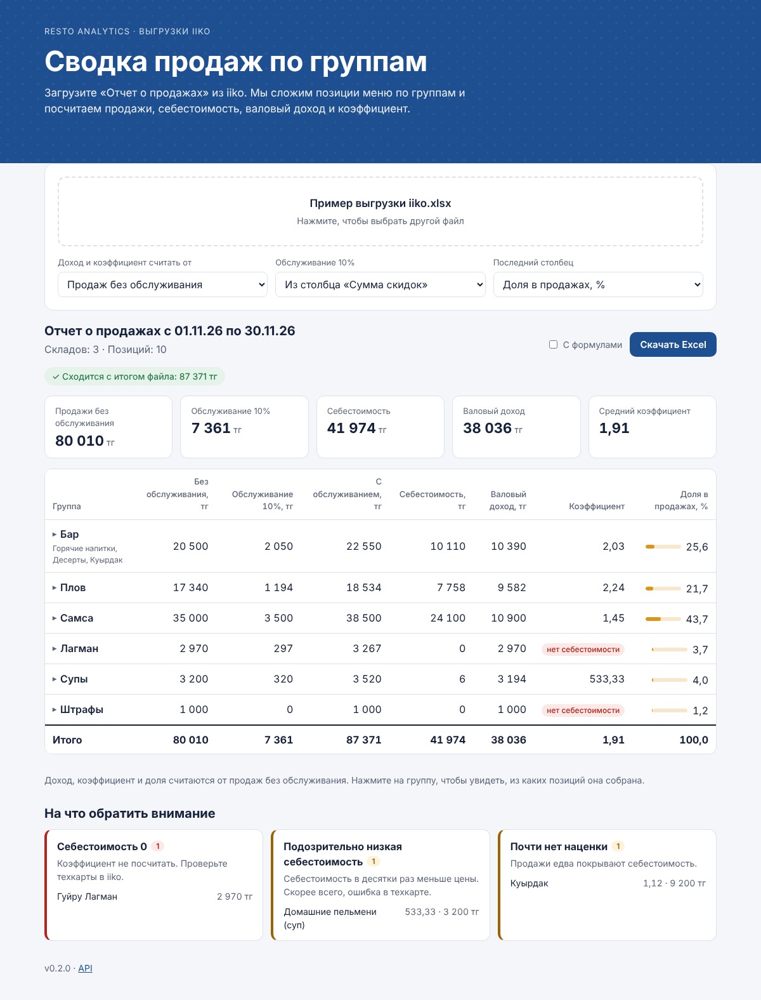

# resto-analytics

[](https://github.com/Giochvanno/resto-analytics/actions/workflows/ci.yml)


Сервис для ресторана: загружаешь выгрузку **«Отчет о продажах» из iiko**, получаешь **сводку по группам блюд**:
продажи, себестоимость, валовый доход, обслуживание 10%, коэффициент и долю каждой группы. Плюс подсказки,
какие позиции в учёте выглядят подозрительно.

Главный интерфейс — **Telegram-бот**: переслал выгрузку в чат и через пару секунд получил обзор месяца
и Excel. Ещё есть веб-страница, HTTP API и командная строка.



> На скриншоте синтетические данные. Настоящие выгрузки с деньгами ресторана в репозиторий не попадают:
> `*.xlsx` и `data/` закрыты в `.gitignore`, а тесты собирают файлы iiko прямо в коде.

## Зачем

Владелец каждый месяц выгружает из iiko отчёт на 100+ позиций и вручную сводит его в таблицу по группам.
Теперь это делается за секунду, с проверкой, что сумма по группам сходится с «Итого» самого файла.

## Как считается

Это сводная таблица. Каждая строка выгрузки — позиция меню. По столбцу **«Категория»** она попадает в строку
сводки (Бар, Плов, Самса…), и внутри строки суммы складываются:

| Столбец | Формула |
|---|---|
| Продажи без обслуживания | Σ («Выручка» − обслуживание) позиций группы |
| Обслуживание 10% | Σ надбавки (в iiko она лежит в «Сумме скидок» со знаком минус) |
| Продажи с обслуживанием | без обслуживания + обслуживание = Σ «Выручка» |
| Себестоимость | Σ «Себестоимость» |
| Валовый доход | продажи **без обслуживания** − себестоимость |
| Коэффициент | продажи **без обслуживания** ÷ себестоимость |
| Доля, % | продажи группы ÷ все продажи × 100 |

**Почему доход считается без обслуживания.** 10% — плата за работу зала, а не за блюдо, и на доставке её нет.
Если включить её в базу, блюда, которые часто берут через агрегаторы, выглядят менее выгодными, чем есть.
Так же наценку и фудкост считают в ресторанном деле — по ценам меню. Если обслуживание остаётся заведению
и его нужно учитывать, достаточно поставить `margin_base = "with_service"`.

Всё это настраивается в [`config/summary.toml`](config/summary.toml): можно выбрать, по какому столбцу группировать,
какие группы вынести отдельно (например, Лагман, который в iiko лежит внутри «Бара»), что исключить и от какой суммы считать доход.

**Проверки данных:** позиции с себестоимостью 0 (коэффициент не посчитать), с подозрительно низкой себестоимостью
(скорее всего, ошибка в техкарте) и с наценкой ниже порога.

## Быстрый старт

```bash
git clone https://github.com/Giochvanno/resto-analytics.git
cd resto-analytics

# 1. Виртуальное окружение
python -m venv .venv
source .venv/bin/activate            # Windows: .venv\Scripts\activate

# 2. Зависимости точно по lock-файлу + сам пакет
pip install -r requirements-dev.txt  # для сервера без тестов: requirements.txt
pip install -e . --no-deps

# 3. Настройки окружения
cp .env.example .env                 # Windows: copy .env.example .env

# 4. Запуск
uvicorn resto_analytics.web.app:create_app --factory --reload   # или: make run
```

Откройте http://127.0.0.1:8000, документация API лежит на `/docs`. На Linux/macOS шаги 1–2 делает `make venv`.

Или в Docker:

```bash
docker build -t resto-analytics .
docker run --rm -p 8000:8000 --env-file .env resto-analytics
```

## Окружение и зависимости

| Файл | Зачем | В git? |
|---|---|---|
| `pyproject.toml` | зависимости диапазонами (`fastapi>=0.115`) — что проекту нужно | да |
| `requirements.txt` | точные версии для запуска (сервер, Docker) | да |
| `requirements-dev.txt` | то же + pytest, ruff, mypy | да |
| `.env.example` | список всех настроек с описанием | да |
| `.env` | ваши значения | **нет** |
| `.venv/` | виртуальное окружение | **нет** |

Lock-файлы генерирует [uv](https://docs.astral.sh/uv/) из `pyproject.toml` с маркерами платформ, поэтому они
подходят и для Linux, и для Windows. После изменения зависимостей в `pyproject.toml`:

```bash
pip install uv && make lock
```

CI проверяет, что lock-файлы не отстают от `pyproject.toml`.

Настройки приложения (переменные окружения важнее `.env`):

| Переменная | По умолчанию | Что делает |
|---|---|---|
| `RESTO_MAX_UPLOAD_MB` | `10` | максимальный размер загружаемого файла |
| `RESTO_SUMMARY_CONFIG` | `config/summary.toml` | файл настроек сводки |
| `RESTO_LOG_LEVEL` | `INFO` | уровень логов |

## Telegram-бот

Отправляете боту выгрузку iiko — он отвечает коротким обзором месяца, детали по кнопкам
(пример на синтетических тестовых данных из `tests/factories.py`):

```
📊 Ноябрь 2026
✓ сходится с итогом iiko

Выручка 87 тыс тг
Валовый доход 38 тыс · коэффициент 1,91
Доход и коэффициент — от продаж без обслуживания.

Больше всего продаж
Самса 35 тыс · Бар 21 тыс · Плов 17 тыс

Выгоднее всего: Супы >100 · Плов 2,24
Слабее всего: Самса 1,45 · Бар 2,03

⚠️ Проверьте в iiko
• нет себестоимости: Гуйру Лагман
• подозрительно низкая себестоимость: Домашние пельмени (суп)
• почти без наценки: Куырдак 1,12

[📋 Все группы] [⚠️ Проблемы (3)]
[📎 Excel] [🔁 Считать с обслуживанием]
```

- **Все группы** — таблица по группам, под ней кнопки групп; нажали «Бар» — позиции бара.
- **Проблемы** — всё, что стоит проверить в учёте iiko, с подсказками.
- **Excel** — та же сводка файлом (три листа), чтобы переслать бухгалтеру.
- **Считать с обслуживанием** — пересчитывает обзор на месте; выбор запоминается для следующих файлов.

Доступ — только по белому списку Telegram ID: в отчётах деньги заведения. Кто не в списке, получает
«нет доступа» и свой ID — его достаточно передать владельцу.

### Запуск

1. В Telegram откройте [@BotFather](https://t.me/BotFather) → `/newbot` → получите токен.
2. В `.env` впишите:
   ```
   RESTO_BOT_TOKEN=123456789:AA...
   RESTO_BOT_ALLOWED_USERS=111111111,222222222
   ```
   Свой ID можно узнать, написав боту до того, как добавите себя: он его покажет.
3. Запустите:
   ```bash
   resto-analytics bot              # локально
   docker compose up -d bot         # на сервере
   ```

Бот работает через long polling: ему не нужен домен, HTTPS или открытые порты — подойдёт любой
VPS или домашний компьютер с интернетом.

Последний отчёт каждого чата бот держит в памяти; после перезапуска файл нужно прислать заново
(история в базе — следующий шаг, см. «Планы»).

### Куда встанет ИИ

Свободный текст («как плов против октября?») сейчас получает подсказку. Ответ формирует
`bot/answers.py: QuestionAnswerer` — чтобы подключить ИИ-агента, достаточно написать класс с методом
`answer(question, stored)` и передать его в `create_dispatcher(answerer=...)`. Факты для агента уже
есть в структурированном виде: `insights.build_overview()` возвращает pydantic-модель, которую можно
отдать LLM как результат инструмента, а проверка сверит каждое число в ответе с этими фактами.

## Использование

**Веб:** открыть страницу, перетащить файл и, если нужно, нажать «Скачать Excel».

**CLI:**

```bash
resto-analytics summary "Отчет о продажах.xlsx"                     # таблица в терминале
resto-analytics summary "Отчет о продажах.xlsx" -o сводка.xlsx       # + Excel
resto-analytics summary "Отчет о продажах.xlsx" --json               # JSON
resto-analytics summary отчет.xlsx --margin-base with_service --last-column efficiency --formulas -o out.xlsx
```

**API:**

```bash
curl -F "file=@Отчет о продажах.xlsx" http://127.0.0.1:8000/api/v1/sales-summary
curl -F "file=@Отчет о продажах.xlsx" -F formulas=true \
     http://127.0.0.1:8000/api/v1/sales-summary/xlsx -o сводка.xlsx
```

| Метод | Путь | Что делает |
|---|---|---|
| `GET` | `/` | страница загрузки |
| `GET` | `/health` | проверка живости |
| `POST` | `/api/v1/sales-summary` | файл → JSON-сводка |
| `POST` | `/api/v1/sales-summary/xlsx` | файл → `.xlsx` |

Необязательные поля формы: `margin_base` (`without_service` / `with_service`), `service_source` (`file` / `percent` / `none`),
`last_column` (`share` / `efficiency`), `formulas` (`true` / `false`, только для xlsx).
Ошибки возвращаются как `{"detail": "понятный текст на русском"}` с кодами 413 (большой файл), 415 (не .xlsx),
422 (не отчёт iiko).

## Архитектура

```
src/resto_analytics/
├── domain/        модели (SaleLine, SalesReport) и деньги в Decimal — без зависимостей
├── parsing/       выгрузка iiko .xlsx → SalesReport (столбцы ищутся по названию, не по номеру)
├── reports/       расчёты: сводка по группам, проверки данных, сверка с «Итого»
├── export/        SalesSummary → .xlsx (openpyxl): «Сводка», «Позиции», «Проверка данных»
├── service.py     единая точка входа в ядро для всех интерфейсов
├── config.py      настройки сводки (pydantic + TOML)
├── settings.py    настройки приложения из env (RESTO_*)
├── insights/      обзор месяца: главные цифры и выводы правилами (факты для бота и будущего ИИ)
├── bot/           Telegram-бот (aiogram 3): экраны, кнопки, белый список, хранилище отчётов
├── web/           FastAPI: API + страница (Jinja2 + чистый JS)
└── cli.py         командная строка
```

```
iiko .xlsx ──► parsing ──► SalesReport ──► reports ──► SalesSummary ──┬─► export (.xlsx)
                                                                        └─► insights ──► бот
                                    интерфейсы: Telegram-бот · web (FastAPI) · cli
```

Решения, которые стоит знать:

- **Decimal для денег.** У float `0.1 + 0.2 != 0.3`, а сумма по группам должна сходиться с итогом файла до тиына.
- **Ядро не знает об интерфейсах.** Веб, CLI и будущий бот вызывают `service.summarize()`. Новый интерфейс
  не трогает расчёты.
- **API без состояния.** Файл не сохраняется и считается в памяти, поэтому сервис масштабируется копиями.
  CPU-работа уходит в threadpool и не блокирует event loop.
- **Парсер терпим к формату и строг к данным.** Порядок столбцов, пустые ячейки группы, числа-строки
  «1 234,50» и лишние листы он переживает. А вот текст в денежном столбце даёт ошибку с номером строки.
- **Excel по умолчанию со значениями.** Так файл одинаково выглядит в Excel, Google Sheets и в превью
  WhatsApp/Telegram. С `formulas=true` производные столбцы пишутся формулами, как в исходном примере.

## Разработка

```bash
make check      # ruff + mypy --strict + pytest (то же, что в CI)
make lock       # пересобрать requirements*.txt
make format     # автоформатирование
```

- **Тесты:** pytest, покрытие ≥ 90% (сейчас ~98%). Синтетические выгрузки iiko собирает `tests/factories.py`.
- **Пересчёт формул:** тест прогоняет Excel с формулами через LibreOffice и сравнивает с нашими значениями
  (пропускается, если LibreOffice не установлен).
- **Проверка на настоящем файле:** только локально:
  ```bash
  RESTO_REAL_FILE=data/отчет_ноябрь.xlsx pytest -m real_data
  ```
- **CI:** GitHub Actions на Python 3.11 / 3.12 / 3.13 + сборка Docker-образа.

### Как добавить новый отчёт

1. Модуль в `reports/` с чистой функцией `build_…(report, config) -> …` и тестами на синтетических данных.
2. Если нужен новый вид выгрузки — парсер в `parsing/`.
3. Экспорт в `export/`, схема ответа в `web/schemas.py`, эндпоинт `/api/v1/…` и функция в `service.py`.

## Планы

- [x] Telegram-бот: отправил выгрузку — получил обзор месяца, кнопки и Excel
- [ ] Загрузка напрямую из iiko (iikoServer API, OLAP-отчёты) без ручной выгрузки
- [ ] История по месяцам в PostgreSQL, сравнение «месяц к месяцу» (в боте — «Плов +8% к октябрю»)
- [ ] ИИ: комментарий к месяцу с проверкой цифр, ответы на вопросы свободным текстом
- [ ] Несколько точек заведения в одной сводке
- [ ] Фудкост и ABC-анализ меню

## Лицензия

MIT
